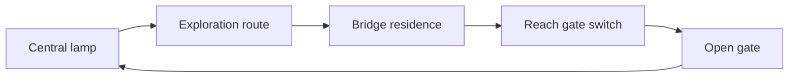

# Doors, locks and shortcuts

[Guide index](README.md) · [Persistence and resets](PERSISTENCE-AND-RESETS.md)

## The pattern

A barrier can control access, reveal a connection between familiar places, or make
the return journey shorter. Its appearance does not tell the whole story: record
where it can be operated, what enables it and which route becomes usable.

| Kind of interaction | What distinguishes it |
| --- | --- |
| Opening from a particular side | Reaching the operating side is the requirement |
| Opening with an item | Possession or another item-related condition permits access |
| Operating a mechanism | The control and the moving barrier may occupy different places |
| Talking at a door | The response is a conversation; see [door conversations](DOOR-CONVERSATIONS.md) |
| No available interaction | Scenery alone does not establish that a door can ever open |

These are descriptive categories, not confirmed engine object types. A particular
gate can combine several conditions.

## Example: a route back to Central Yharnam's lamp

The route through the bridge residence leads to stairs and a switch opening the
gate near Gilbert's house. It connects later parts of the area back to the Central
Yharnam lamp. The [Central Yharnam reference](https://www.bloodborne-wiki.com/2015/03/central-yharnam.html)
describes this as Gilbert's Gate and explains the approach.

Design interpretation: the reward is a change in the area's connections. The player
first discovers the longer route, then gains a shorter journey through familiar
space. Recognition of the lamp makes the value of the connection immediately legible.
A diagram of that idea, rather than a geographically accurate map:

The loop explains why a shortcut can feel like substantial progress without adding
an item or improving the character's stats.

## Example: an item requirement

The Hunter Chief Emblem opens the main gate to the Great Cathedral's round plaza.
This is a useful contrast with reaching a switch: an inventory condition participates
in access. See the [emblem reference](https://www.bloodborne-wiki.com/2015/03/hunter-chief-emblem.html).
This example does not establish that the emblem is required for every route into
the surrounding area.

Design interpretation: a lock can connect exploration to another system, such as
obtaining or purchasing an item. Describe the specific barrier's requirement
separately from the area's overall accessibility.

## Opening is more than an animation

For an implementation investigation, separate permission to interact, player/object
animation, traversable collision and the result restored on a later visit. Seeing
the gate move answers only part of the question. Check passage from both sides and
the exact [reset boundaries](PERSISTENCE-AND-RESETS.md) before describing persistence.

Useful questions for a concrete barrier:

- What links the control, moving object and blocked passage?
- Which condition selects an opening action or refusal message?
- When does passage become possible relative to the animation?
- What happens if the interaction is interrupted?
- On map load, what selects the closed or open state?

**Evidence status:** examples above are supported by community references; the route
analysis is interpretation. Individual map entities, event IDs, collision changes
and save conditions have not been traced or gameplay-tested for this guide. Use
the [research method](RESEARCH.md) to extend it.

## Reusable lesson

For an original mod, design the connection before decorating the barrier. Identify
the first approach, the requirement, the shorter return route and what the player
recognizes when the loop closes. Specify the restored state as well as the opening.
